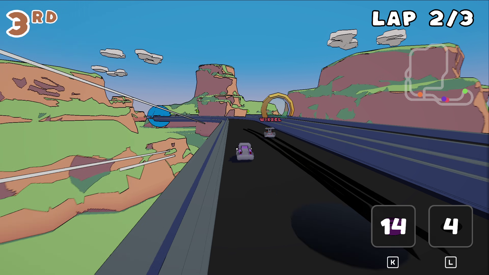
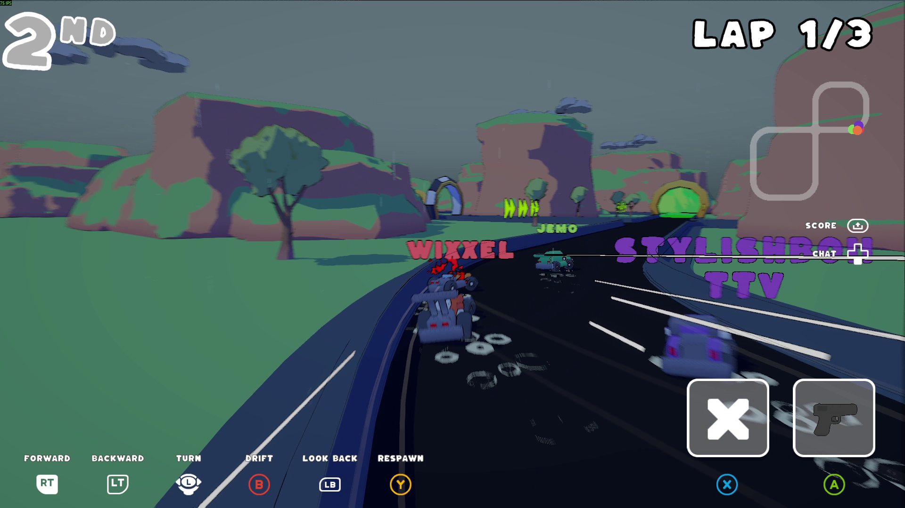
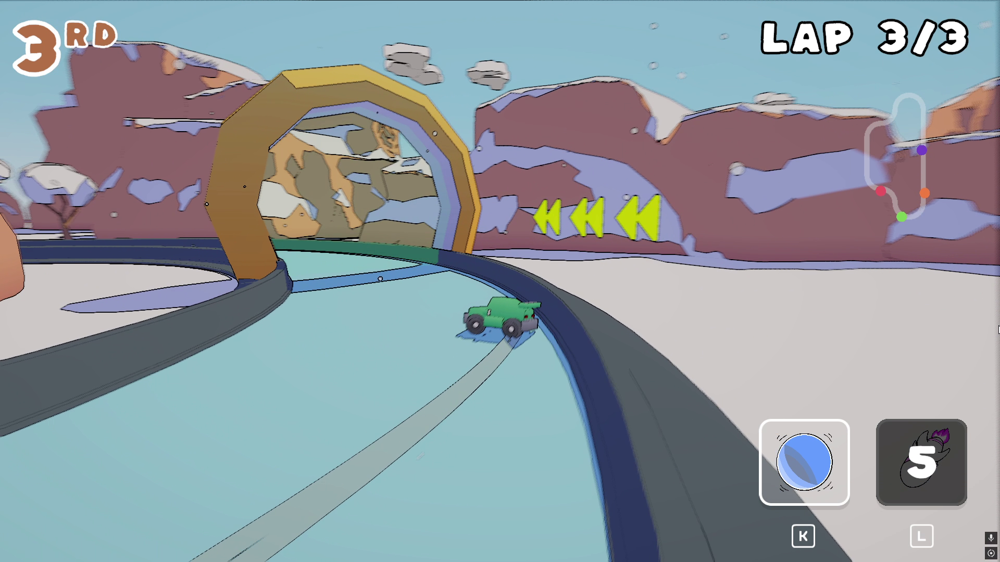
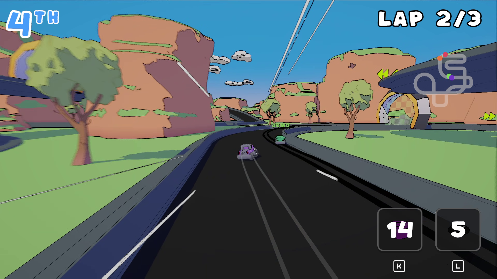

## Overview

[Payback GP](https://store.steampowered.com/app/4925650/Payback_GP/) is an online racing roguelike for up to 4 players, and my first commercial game! I worked on it for about 6 months, with an artist helping me on the capsule and the power up icons. The Steam page and the trailer explain the game better than I could here, so this page is more about **how** I made it.

[Check it on Steam](https://store.steampowered.com/app/4925650/Payback_GP/)

## Why I made it

I started this game to learn multiplayer in Unity. I had already tried Netcode for GameObjects (NGO) before, so this time I wanted to understand how **Photon Fusion** works, and honestly it was pretty easy to get into.

## Kart architecture

The kart is the heart of the game, so I split its prefab into components with one job each:

- **KartController**: the network side, it handles inputs, networked state and RPCs
- **KartPhysics**: the movement (acceleration, steering, grip, drift)
- **KartView**: what you see of the kart
- **KartFX**: the visual effects (particles, trails...)
- **KartSFX**: the sounds

This way the network logic never gets mixed with the presentation. When something was wrong I knew where to look: if a kart was in the wrong place it was the controller or the physics, if it only *looked* wrong it was the view. It also made it easy to add new power ups that change the kart's stats without touching everything else.

## Networking

The game uses a host + client architecture: one player hosts the session and the others join it.

- **State synchronisation**: the important data lives in networked state and Fusion keeps it in sync for everyone, instead of sending events for everything.
- **The host is always the single source of truth**: positions, score, money and power ups are all decided by the host.
- **Client prediction**: each player drives their own kart locally so the controls feel instant. The tricky part is that karts can change stats during a game (speed, acceleration, grip...), so when a stat changes I don't only apply it on the host, I also apply it on the owning client, otherwise its prediction doesn't match the host anymore and the kart gets corrected all the time. I also made 2 active power ups predicted on the client, the **Speed Boost** and the **Jump**: they move your own kart, so waiting for the host to answer would add a delay every time you press the button. With prediction they trigger instantly.
- **Polishing remote players**: the other karts are smoothed with interpolation, so they don't jitter or teleport even with some latency.
- **RPCs, when and to who**: choosing what really needs an RPC, and sending it only to the players that need it instead of everyone.

## Testing: latency and playtests

Testing multiplayer on your own PC is a trap: with zero latency everything looks perfect. So most of the time I was testing with **simulated latency**. That's how the real problems show up early: corrections on your own kart when the prediction is wrong, remote karts jittering, or effects playing at the wrong moment. If it feels good with latency, it feels great without it.

The other big part of testing was my friends. They played most of the builds with me, online in real conditions, and gave me feedback after the sessions. A lot of the polish and balancing came from that: what felt unfair, what wasn't clear, and what was the most fun.

## Game feel: faking it

One thing I learned on this project: it only needs to *look* real, it doesn't need to *be* real. The game has weather variations, and for the snow there is no giant particle emitter covering the whole map. Each player just has a snow emitter attached to their own view, locally. Everyone sees snow everywhere, but it costs almost nothing. It's just an illusion hehe.

I also spent a lot of time on the sense of speed, like a supersonic boom effect when you go over a speed threshold. Small feedbacks like that make a big difference for an arcade racing game.

## Publishing on Steam

Since it's my first game on Steam, I also had to learn everything around it: integrating the Steamworks API in the game with [Steamworks.NET](https://github.com/rlabrecque/Steamworks.NET) (a C# wrapper for Unity), adding Steam achievements, and setting up the Steam store page (capsules, screenshots, description...). The page is public now, the game is not out yet!

## What I Learned

- Multiplayer with Photon Fusion: state synchronisation, client prediction, interpolation, RPCs
- Keeping the host as the single source of truth, while keeping clients responsive
- Splitting a complex prefab into components with clear responsibilities
- Always testing multiplayer with latency, and playtesting with real players
- Using playtest feedback to polish and balance the game
- Polish: UI, sense of speed, feedback, and faking effects for game feel and performance
- Integrating the Steamworks API with Steamworks.NET (achievements included) and publishing a store page
